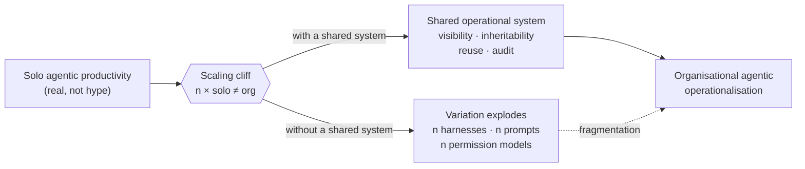
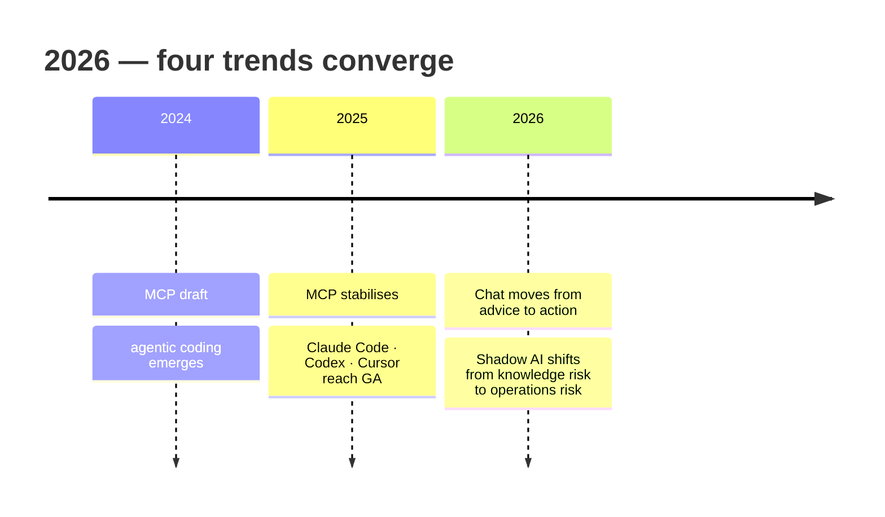
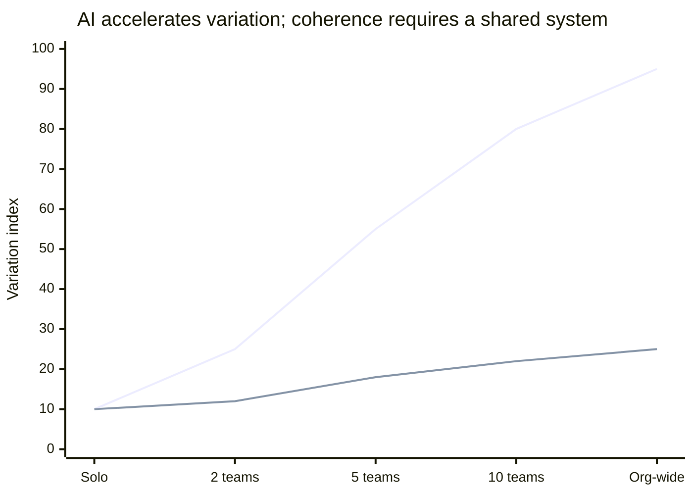
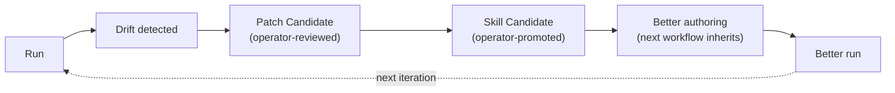

# The Thesis — Organisational Agentic Operationalisation

> **Reading time:** ~15 min
> **Audience:** CTO, Platform Owner, Buyer-side Architect
> **Read next:** [system requirements](./system-requirements.md) · [positioning](./positioning.md) · [glossary](./02-concepts.md)

---

## 1. Summary

A new layer is emerging in enterprise software because of agentic AI — what we call **organisational agentic operationalisation**. The market term for the same thing, the one that fits a sentence, is the **operational AI execution layer**.

Models are mature. Agents are mature. Workflow and integration platforms are mature — most of them more capable than strictly required. The bottleneck is *not* in any single component. It sits **between** them: in the mediation of an organisation's specific structure, culture, knowledge, priorities, and ways of working to those mature layers — and in the **daily improvement and application** of that knowledge.

Agentic productivity does not automatically scale organisationally. *Operationalisation* is not the bottleneck itself; it is the **form** in which this mediation bottleneck dissolves — organisation-specific context as a versioned, shared, learnable operational layer. A new layer is emerging to carry this.

> ***The next relevant software layer after SaaS is organisational agentic operationalisation.***

The category is new, hard to copy, and model-/UI-/vendor-independent. Two sentences ground the rest of this document:

- *Enterprise AI does not fail at the models; it fails at the absence of controlled execution.*
- *Once AI touches operational systems, conversation governance is no longer enough.*

### The mediation bottleneck is operationally measurable

The mediation gap is not a feeling; it is observable in industry numbers. Today's defaults around integration and context transfer leave hard quantitative traces:

- **Only 27 % of applications are integrated** across the average organisation — i.e. roughly **three out of four applications remain disconnected**, while organisations operate **around 900–1,000 applications** on average. *Source: [2026 MuleSoft Connectivity Benchmark Report](https://www.mulesoft.com/lp/reports/connectivity-benchmark) (n = 1,050 IT leaders, with Vanson Bourne and Deloitte Digital); the 1,000-app baseline already appears in the [2023 Salesforce report](https://www.salesforce.com/news/stories/connectivity-report-2023/).*
- **USD 4.7 million per year**, on average, is spent on implementing custom integrations — a 21 % increase from USD 3.7 million the year before. *Source: [MuleSoft Connectivity Benchmark Report](https://www.mulesoft.com/lp/reports/connectivity-benchmark); custom-integration labour cost has been tracked across successive editions of the report and has risen consistently: USD 3.5 M, then USD 3.65 M, then USD 3.7 M, and most recently USD 4.7 M.*
- **80 % of organisations** report that integration challenges slow or hamper their digital transformation, and the same share names data integration as the principal obstacle to AI adoption. *Source: [2025 MuleSoft Connectivity Benchmark Report](https://blogs.mulesoft.com/news/connectivity-benchmark-report/).*
- Developer-time devoted to building and maintaining integrations is the hardest of these to pin to a single primary source; industry summaries put the share at roughly **a third to forty percent** of enterprise development time, consistent with [Postman's 2025 State of the API Report](https://www.postman.com/state-of-api/2025/) finding that **69 % of developers spend 10+ hours per week on API-related tasks**.

Agentic AI does not change this mediation problem — it amplifies it. The mediator is no longer code between systems; it is an autonomous model deciding what action to take on the organisation's behalf. The bottleneck moves from *"how do these systems connect?"* to *"how does the agent know what this organisation actually does?"* The numbers above describe the pre-AI baseline of the same gap this document is about.

The numbers are not a critique of any platform category — they are the operational footprint of mediation running today through lone heads and lone scripts, instead of through a shared, learnable operational layer.

---

## 2. The Three Core Ideas — a Hierarchy, Not Three Parallel Claims

Everything else in this document — and in the [system requirements](./system-requirements.md) and the [positioning](./positioning.md) — subordinates to one master idea. The other two are derivations from it.

**Idea 1 — The Problem (master claim).** Agentic productivity does not automatically scale organisationally.

If Idea 1 is true, the immediate question is *what is missing*. Two derivations follow.

**Idea 2 — The Category (follows from Idea 1).** The bottleneck is therefore not intelligence — supplied generically by model vendors — and not workflow execution either — supplied by mature platforms. It is the **mediation of organisation-specific context** to those mature components: structure, culture, knowledge, priorities, working procedures. *Operationalisation* is the form this mediation takes — the organisational machinery that turns generic intelligence into repeatable, reviewable, learnable operational work, with a learning loop that improves the same operation a little on every run.

**Idea 3 — The Moat (follows from Ideas 1 and 2).** If intelligence is supplied externally and operationalisation is the bottleneck, the only durable advantage an organisation can build for itself is the one that compounds locally over time — *organisational context accumulation*. The moat is not any single feature.

Above all three sits the **central axiom** of this set of documents — the sentence that compresses Ideas 2 and 3 into a single operational claim:

> ***The operating model improves because the organisation learns — and that is the part the organisation can actually control.***

The rest of this document explains why Idea 1 is true (and therefore why Ideas 2 and 3 must follow).

---

## 3. The Real Problem Domain — Solo Leverage vs. Organisational Operationalisation

Anyone who has spent a weekend with Claude Code, Codex, or Cursor knows the feeling: in ten minutes the agent finishes what would have taken half a day. **This solo leverage is real, not hype, and must not be dismissed.** Individual agentic work is genuinely productive.

But that is exactly where the problem begins: *individual agentic productivity is not the same thing as organisational agentic operationalisation*.

Solo works because a large part of the system still lives *inside the person* — taste, instinct for drift, local scripts, prompt habits, diff-reading hygiene, a mental model of the codebase and the target systems. That does not scale. The moment many teams work against real products, the question changes:

- **Before:** "Can an agent produce useful work?" — Answer: yes.
- **Now:** "Can the organisation **repeatably**, **safely**, **reviewably**, **maintainably** — across teams and over time — produce useful work with agents?" — A completely different question.

This is the **scaling cliff**. AI accelerates not only delivery but also *variation*. When every employee builds their own harness, prompts, review, and permission model, you do not get coherent amplification — you get a pile of local optima that do not compose. The costs show up *downstream*: larger patches, inconsistent quality, missing evidence, brittle reviews, security exceptions, duplicated workflows, knowledge trapped in private chat histories.

*Solo agentic productivity does not become organisational operationalisation by repetition. Without a shared system, n-times solo breaks at the scaling cliff. A shared operational system closes this gap for the operational execution lane — governance here does not reduce speed, it reduces the friction of incoherence.*

---

## 4. Why Now? — The Urgency

The phenomenon is not new in principle. It becomes acute in 2026 because four trends converge.

- **MCP standardises tool access.** Model Context Protocol — the AI-side connector standard — lets AI clients connect to production systems with minimal friction; the integration barrier that used to slow this down is gone.
- **Agentic coding wires AI directly to production systems.** Claude Code, Codex, and their peers do not just suggest — they execute commands, write to real systems.
- **Chat moves from advice to action.** AI surfaces no longer only answer; they *trigger actions*.
- **Shadow AI shifts from a knowledge risk to an operations risk.** The old worry was "what data flowed into the model?" The new one is "which *action* against which production system did an ungoverned AI just trigger?"

The deeper sharpening: at the core, the line between "humans act" and "software acts" is dissolving. This is exactly why classical IAM models, conversation logs, and seat governance no longer suffice — they were designed for a world in which only humans triggered actions.

So long as AI advised, conversation governance was enough. Once AI *acts*, a control layer for the operational execution itself is required — and the transition is happening now.

---

## 5. The Four Structural Shifts (the theory itself)

### 5.1 Solo agentics fragments organisations

More solo actors, each with their own harness, prompts, conventions, and permissions, means *more variation, not more coherence*. This is not a maturity problem; it is structural. As long as operational logic lives in individual people, scaling has no shared substrate. Organisations fragment under naive agentics *faster* than under classical software, because agentic tools raise the rate at which variation is produced.

*Two lines: the upper one is ungoverned solo scaling (variation grows with team count); the lower one is the same organisation on a shared operational system.*

### 5.2 Operational context becomes a first-class infrastructure resource

As long as humans translated intent → spec, documentation, wikis, and "ask the senior" were enough. The moment a model takes over that translation, tenant-specific knowledge (interfaces, policies, failure modes, established patterns) becomes a *first-class input* into every agentic action. What used to be documentation becomes infrastructure. What used to be implicit must become explicit and machine-readable.

### 5.3 Operational knowledge becomes accumulable, versionable, inheritable — Git for operational organisational logic

This is the theoretically strongest claim of the document, and the one with the largest downstream implications:

> ***Operational knowledge has so far been implicit, situational, bound to people, hard to transfer. Under governed agentic operationalisation it becomes for the first time machine-readable, versioned, reusable, auditable, and accumulative over time — in effect, Git for operational organisational logic.***

The claim only bites if the prevailing default is named. The default in practice is that integration is treated as a **task**: built once for a project, then handed over to whichever script lives on whichever server with whichever person knows it. Yet integration code is never a one-off: API versions shift, data shapes drift, security standards tighten, business rules move. Treating integration as a task therefore produces tribal knowledge on lone heads and lone scripts on lone servers. After a while no one remembers *why* the script was written that way, *which* domain problem it solved, *when* it will fail next.

Treating integration as a **process** instead requires a learning loop with organisational memory. That is precisely what a versioned workflow artefact plus drift detection plus operator-reviewed Patch Candidates plus Skill Candidates provides: the daily improvement of operational logic stops being tribal and becomes infrastructural. This closes the chain — mediation bottleneck → operationalisation as the form of the answer → versioned workflow + compounding loop as the substance.

The workflow itself thereby becomes a *versioned organisational artefact*: an organisation accumulates not only software (source code) and documentation, but for the first time **operationalised action systems** — the literal procedures by which it acts on production systems, expressed as reviewable, diffable, rollbackable artefacts. This has six second-order consequences that, taken together, are larger than they look:

- **A new class of organisational assets.** Operational workflows join source code and documentation as first-class assets an organisation owns. They appear on the same *balance sheet* of what the company can carry forward, sell, audit, and inherit. Once a workflow has a version history, an owner, an approval trail, and a known production behaviour, it has the legal and operational properties of an asset.
- **Learning mechanics shift from individual to systematic.** Today, organisational knowledge mostly leaves with the people who hold it. Under governed operationalisation, the same Drift → Patch Candidate → Skill Candidate loop converts each individual insight into a tenant-wide artefact. The organisation learns from its operations the way it currently learns from its source-code history — continuously and structurally, not by accident.
- **Lock-in shifts from tooling to context.** Switching cost stops being "we use tool X" and starts being "we have N years of accumulated operational context — Skills, Workflows, Knowledge — that our authoring is grounded on". Tool replacements become cheap; *context replacements* become very expensive. This is the source of the platform's durable advantage — and a different kind of lock-in than enterprise software has had so far.
- **Audit logic changes scope.** Audit moves from being a record of *what was said to a model* to a record of *what action ran, on which workflow version, with which inputs, approved by whom, against which production system*. The unit of evidence shifts from conversation-grade to action-grade. Compliance programmes built on the new unit look fundamentally different.
- **Knowledge transfer becomes pull-based.** Today, knowledge transfer between teams is push-based: someone has to write the runbook, give the talk, train the new hire. When workflows, skills, and knowledge are first-class tenant assets, a new team *inherits* them by joining; transfer is no longer an active project but a passive consequence of being in the same operating model.
- **Operational competence becomes a measurable capital stock.** Once you can count workflows, skills, knowledge sources, drift-survivals, and inherited patterns, you can measure (and price) the accumulated operational competence of an organisation as a capital quantity, not as a vague cultural property. This is plausibly the largest long-term implication of this shift — and the one we deliberately understate, because the cleanest way to make it credible is to let it emerge from running systems rather than to claim it upfront.

On-/offboarding, knowledge management, audit/compliance, and the organisation's notion of *what it owns* change in character — structurally, not gradually.

### 5.4 A new middleware layer emerges historically — not by accident

The historical sequence: models become good enough → tool access standardises (MCP) → costs fall → agentics democratises → variation explodes → organisations lose coherence → a new operational coordination layer *must* emerge. The parallel is the emergence of database middleware in the 80s, or SaaS platforms in the 2000s — software shifts that were not optional once their preconditions converged.

---

## 6. Why Not Just OpenAI?

The question deserves a firm answer.

Foundation-model providers optimise **global intelligence** — a model that works well everywhere. **Organisational operationalisation** is the exact opposite: *local* (tenant-specific), *historically grown* (skills/knowledge/workflows curated inside this particular organisation), *policy-bound* (RBAC/approval/audit follow org rules), and *context-accumulative* (each run makes the next better *for this specific tenant*). These four properties are structurally foreign to the business model of a global model vendor.

The durable layer emerges not in the model, but in the operating model. Intelligence and operationalisation are two different problems, two different platform categories, two different moats — complementary, not competing. A platform in this new category does not compete with Anthropic / OpenAI / Google for the better model; it occupies the layer in which an organisation turns generic intelligence into *its own* repeatable operational competence.

---

## 7. Why a Shared System? — The Centralisation Argument

Reasonable counter-question: why is "every team with GitHub + Claude Code + local MCPs + internal conventions" not enough? The surface answer is "you lose visibility, reuse, audit, inheritability" — and that is true, but it is downstream. The deeper claim is:

> ***Organisational learning requires shared operational experience. Not shared tooling. Not shared governance. Commonly operationalised reality — the same operational artefacts being run, observed, and repaired by the organisation as a whole.***

The point is not that local teams cannot improve locally — they can. The point is that *organisational* memory only forms where operational experience is *shared* at the level of the artefact, not at the level of the tool that produced it. Two teams that use the same coding assistant on the same kind of API but never see each other's runs do not build organisational learning; they build two parallel personal learnings that happen to look similar. The substrate of organisational learning is *the artefact someone else just ran and you can now see, inherit, and repair*.

The four often-cited properties of a shared system are then *expressions* of this deeper requirement, not the requirement itself:

- **Visibility** — operational experience that no one else sees does not compound.
- **Inheritability** — experience that does not transfer to other teams does not accumulate organisation-wide.
- **Reuse** — experience that does not become a reference for future work does not shape the next run.
- **Audit** — experience without traceable structure cannot become evidence and cannot be acted on as a class.

Each is necessary because *shared operational experience* requires it. None of them is the primary claim. *Local optimisations do not produce organisational memory.*

Without a shared system, agentics stays a **toolkit**; with one, it becomes a **platform**. This is the difference between "many teams use Claude Code" and "the organisation has an operational AI layer".

---

## 8. Four Platform Effects — Over Context, Not Over Users

Classical platform effects (network effects, reuse, standardisation) here do not arise from end-user scale. They arise from **operationalised context accumulating per tenant over time**. Four interlocking effects:

- **Learning network effect** — *more runs → better authoring*. Drift and repair signals from every run flow back into the tenant context as Patch and Skill Candidates.
- **Context network effect** — *more workflows → more reuse*. Existing workflows become reference cases the next authoring run can clone or extend instead of starting from scratch.
- **Governance network effect** — *more standardised executions → less friction*. Approval patterns, hooks, and policy rules validated in one area become applicable in others — less ad-hoc decision-making.
- **Organisation network effect** — *new teams do not start from zero*. Onboarding a team reduces to identity + roles; the tenant's skills, workflows, and knowledge are immediately available.

The compounding formula — recurs by name across all three documents and is shown here in full once:

> **Run → Drift → Patch Candidate → Skill Candidate → Better Authoring → Better Run.**

Every run makes the next one better — systematically, not dependent on individual vigilance. This is the compounding that does not emerge in a LangGraph + Vault + RBAC build.

These four effects reinforce each other (more workflows produce more runs, more runs produce more skills, more skills produce better authoring). The stack becomes *exponentially harder to catch over time* — without any end-user network.

---

## 9. What Changes for Organisations

For the first time, organisations begin to accumulate **operationalised action systems** alongside source code and documentation. Workflow becomes an organisational artefact in the same sense that code became one in the 1990s and infrastructure became one in the 2010s. A new asset class enters the balance sheet of how a company functions operationally — and a new class of operating decisions accompanies it.

This is the lens through which the next decade of enterprise software should be read. Not "AI gets cheaper" — that is a precondition. Not "agents get smarter" — also a precondition. The shift is: **agentic competence becomes an organisational property rather than an individual one**, and a new software layer is required to make that shift visible, auditable, and compounding.

The shortest way to say all of this — the iconic compression:

> ***Your operating model used to live in PowerPoint. Now it runs.***

The strategic-management literature has used "the operating model" for decades to describe how a company actually functions — and it has always been a slide deck, a diagram, an organisational description. Under organisational agentic operationalisation, the operating model stops being a description and becomes *the thing that runs* — versioned, audited, inheritable, accumulating. That is the category.

The vocabulary triad — *organisational agentic operationalisation* (theory term), *operational AI execution layer* (market term), **The Operating Model** (iconic short term) — is defined in the [glossary](./02-concepts.md#group-0-strategy-vocabulary).

---

## Further reading

- [system requirements](./system-requirements.md) — what such a system must do.
- [positioning](./positioning.md) — how this reference implementation realises it.
- [glossary](./02-concepts.md) — every term used here, defined once.
- [platform architecture](./01-platform.md) — developer-side architecture of this reference implementation.

---

## Sources

**Research literature** (not inline-cited; provided for reproducibility).

- Yao et al., *ReAct: Synergizing Reasoning and Acting in Language Models*, ICLR 2023 ([arXiv:2210.03629](https://arxiv.org/abs/2210.03629)).
- Lewis et al., *Retrieval-Augmented Generation for Knowledge-Intensive NLP Tasks*, NeurIPS 2020 ([arXiv:2005.11401](https://arxiv.org/abs/2005.11401)).
- *A Survey on Evaluation of LLM-based Agents*, 2025 ([arXiv:2503.16416](https://arxiv.org/abs/2503.16416)).
- *Evaluation and Benchmarking of LLM Agents: A Survey*, KDD 2025 ([arXiv:2507.21504](https://arxiv.org/abs/2507.21504)).
- *A Survey on Large Language Model based Human-Agent Systems*, 2025 ([arXiv:2505.00753](https://arxiv.org/abs/2505.00753)).

**Industry / market context.**

- MindStudio — *What Is an Agent Harness? The Architecture Behind Claude Code, Codex, and Cursor*.
- Addy Osmani — *Agent Harness Engineering*; Medium (A. Masood) — *Agent Harness Engineering — The Rise of the AI Control Plane*.
- GitHub Changelog (2026-02-26) — *Enterprise AI Controls & agent control plane*.
- VentureBeat — *Claude's next enterprise battle is not models: it's the agent control plane*.
- *Temporal vs. LangGraph (2026)*; LangChain docs — *Durable execution*.
- Grant Thornton — *2026 AI Impact Survey* (78 % without audit confidence within 90 days).
- Lumenova — *The Agentic AI Governance Gap of Early 2026*.
